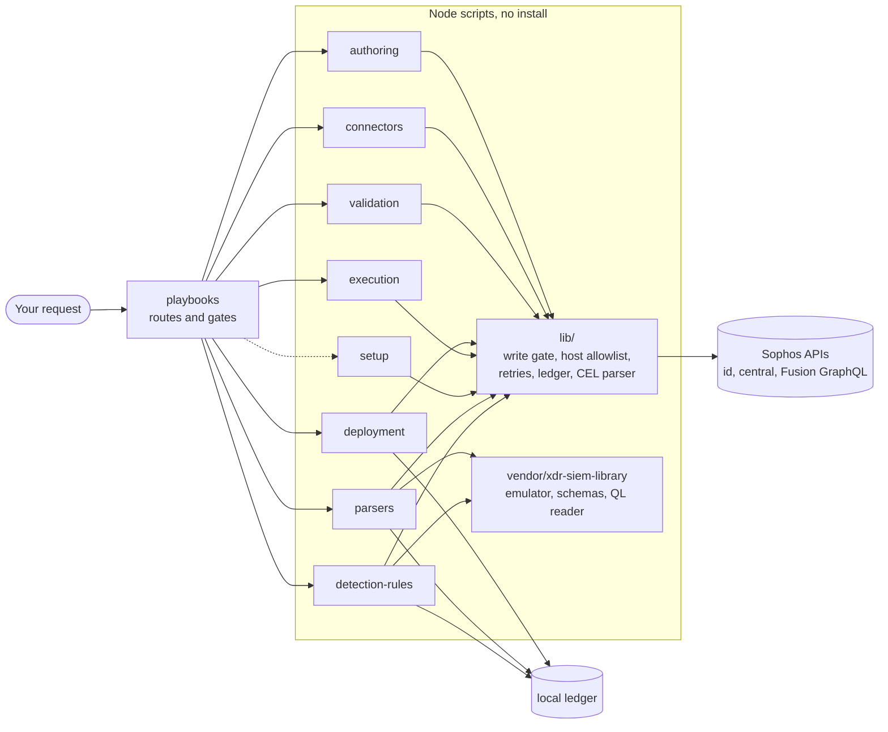

<p align="center">
  <br>
  <picture>
    <source media="(prefers-color-scheme: dark)" srcset="assets/sophos-logo-white.svg">
    
  </picture>
</p>

# Sophos Fusion Skills

[](CHANGELOG.md)
[](https://github.com/Aaronjacobs000/sophos-fusion-skills/actions/workflows/ci.yml)
[](LICENSE)

> [!IMPORTANT]
> This is an unofficial project. Sophos did not make it and does not support it, so report problems here rather than to Sophos Support. Use it at your own risk, and try it on a non-production tenant first.

Ask your coding agent for a Sophos Fusion playbook in plain words. These skills look up the real connectors, triggers, and CEL functions on your tenant, write the template, check it offline and on the tenant, import a test copy, run it, and read the log back to you. Every write waits for your yes, and everything a run creates can be rolled back.

They also build custom parsers for Sophos NG-SIEM from your sample lines, and detection rules and an automatic case rule for those sources. Samples are masked and stay on your machine. Each parser and rule is tested offline, then in the tenant's own engine or Data Lake Search, before it is installed off.

The skills call the Sophos Fusion API through small Node scripts in this repository. There is no MCP server and nothing to install beyond Node 22.

## Contents

- [What you can ask for](#what-you-can-ask-for)
- [What happens when you ask](#what-happens-when-you-ask)
- [Install](#install)
- [Connect a tenant](#connect-a-tenant)
- [The skills](#the-skills)
- [How it fits together](#how-it-fits-together)
- [Safety model](#safety-model)
- [Limits](#limits)
- [Run the scripts by hand](#run-the-scripts-by-hand)
- [Examples](#examples)
- [Testing](#testing)
- [Troubleshooting](#troubleshooting)
- [Contributing and releases](#contributing-and-releases)

## What you can ask for

Plain requests work, and naming a skill is optional. A few prompts to try:

- "Write a Sophos Fusion playbook that adds a comment to a case when it closes as a true positive, saying how many detections it had. Validate it but don't deploy it."
- "Build a connector for the FIRST EPSS API and test it on my lab tenant."
- "Deploy this template to the lab tenant as a test copy and run it once."
- "My playbook says Completed but nothing happened. Here's the execution ID."
- "What verdict names does this tenant use for closed cases?"
- "Here are some lines from our door access system. Build a parser for them and test it on the lab tenant."
- "Add detection rules for failed admin logins on that parser's records, and one case per source IP."
- "Remove everything you created in the last test."

## What happens when you ask

For the first prompt above:

1. The `playbooks` skill reads the request. It sees authoring and validation, and no deployment.
2. `authoring` asks the tenant what exists. It searches connectors ("add a comment to a case"), reads the `Taegis.Case` actions, pulls the case event shape, and looks up the `case*` CEL functions.
3. It writes `template.yaml` from a skeleton. The trigger is a case Update event with a filter that fires once, when the case closes. A guarded count step and a comment step follow, with an outcome that says what happened.
4. It writes `cel-cases.json`: the filter, the verdict check, and the comment text, each against sample events.
5. `validation` runs the offline rules, then the tenant's own DSL check, then the CEL cases in Fusion's engine. Each prints a short result.
6. It stops and reports: file paths, checks passed, and how to deploy if you want to.

Ask it to deploy too, and it keeps going. It names the tenant and asks before each write. Then it imports a `ZZTest_` copy, reads it back, diffs the export against your file, and creates a disabled instance. It tells you how to roll it all back.

## Install

| Assistant | Tested | Install |
| --------- | ------ | ------- |
| Claude Code | yes | `/plugin marketplace add Aaronjacobs000/sophos-fusion-skills`, then `/plugin install sophos-fusion-skills@sophos-fusion-skills` |
| Codex | no | `codex plugin marketplace add Aaronjacobs000/sophos-fusion-skills`, then install from `/plugins`. Or link the skills (below) |
| GitHub Copilot CLI | no | `copilot plugin install Aaronjacobs000/sophos-fusion-skills` |
| Cursor | no | Clone into `~/.cursor/plugins/local/sophos-fusion-skills`, then run Developer: Reload Window |
| Gemini CLI | no | Link the skills (below). `GEMINI.md` imports `AGENTS.md` |
| Anything else | no | Point it at `AGENTS.md` and `skills/playbooks/SKILL.md` |

Claude Code is the only assistant tested so far. The others follow each tool's published plugin or skills format, but nobody has run them yet. Reports are welcome.

From a local clone:

```bash
git clone https://github.com/Aaronjacobs000/sophos-fusion-skills.git
claude --plugin-dir ./sophos-fusion-skills
```

To link the skills for assistants that read `~/.agents/skills/` (Codex, Gemini CLI, Copilot CLI, Cursor):

```bash
mkdir -p ~/.agents/skills
for s in "$PWD"/sophos-fusion-skills/skills/*; do ln -s "$s" ~/.agents/skills/; done
```

On Windows, Git Bash's `ln -s` makes copies by default. A copied skill can't reach the repository's `lib/` folder, so its scripts fail. Use directory junctions, which need no admin rights or Developer Mode. Paste these lines into Command Prompt (cmd.exe) in the folder that holds the clone:

```bat
mkdir "%USERPROFILE%\.agents\skills"
for /d %G in (sophos-fusion-skills\skills\*) do mklink /J "%USERPROFILE%\.agents\skills\%~nxG" "%~fG"
```

The scripts find their shared code through the links, so they run from there too. The skill names (`playbooks`, `setup`, `authoring`, and so on) are generic, so check for clashes with other skills in that folder.

## Connect a tenant

You need a Sophos API credential (client ID and secret). Create one on the API Credentials page in Sophos Fusion, under [Global Settings > Access Control](https://docs.sophos.com/fusion/customer/help/en-us/ManageYourProducts/GlobalSettings/AccessControl/APICredentials/). A Super Admin role covers everything here.

Ask your agent to "set up Sophos Fusion credentials", or run this yourself:

```bash
node skills/setup/scripts/profile.mjs add --name lab --kind test --client-id <client-id> --prompt
node skills/setup/scripts/profile.mjs test --profile lab
```

`--prompt` asks for the secret in your terminal without echoing it. Never paste a secret into a chat. You can also give a 1Password reference (`--client-secret-op "op://Vault/Item/field"`), or set `SOPHOS_FUSION_CLIENT_ID` and `SOPHOS_FUSION_CLIENT_SECRET`.

Profiles are stored in `~/.config/sophos-fusion-skills/profiles.json`, mode 0600. Each one is `test` or `production`, and the default is `production`. Writes on a production profile need an extra flag.

The self-test gets a token, finds the credential type and region, runs one read-only Fusion query, and lists what the credential may do.

Partner and organization credentials reach many tenants, so they need a target:

```bash
node skills/setup/scripts/profile.mjs tenants --profile mssp --search acme
node skills/setup/scripts/profile.mjs add --name mssp --tenant <tenant-uuid>
```

Any command also takes `--tenant <uuid>` for a single run. The scripts check the tenant is one the credential can see and use the region Sophos reports for it. Tenant credentials are tested live in two regions. Partner and organization credentials are covered by unit tests only.

## The skills

| Skill | Use it to | Scripts |
| ----- | --------- | ------- |
| `playbooks` | route a request through the phases in order, stop at a failed check, and carry IDs along | none |
| `setup` | add profiles, pick a partner's target tenant, run the self-test | `profile.mjs` |
| `authoring` | look up connectors, triggers, event shapes, interfaces, and CEL functions; write `template.yaml` and its CEL cases | `catalog.mjs`, `scaffold.mjs` |
| `connectors` | write a custom HTTP connector and test one action live | `connector.mjs` |
| `validation` | run offline rules, the tenant's DSL check, and CEL truth tables | `validate.mjs` |
| `deployment` | import test copies, export and diff, create connections, disabled instances, filters, and schedules, enable or publish, list and export, roll back | `deploy.mjs`, `ledger.mjs` |
| `execution` | run Generic Trigger instances, watch them, read logs, and diagnose failures | `run.mjs` |
| `parsers` | mask samples, draft a custom parser, test it offline and in the tenant's engine, install it off, turn it on, confirm it on real ingest, and share it with the library | `parser.mjs` |
| `detection-rules` | write custom detection rules for a custom parser's records, test them offline and in Data Lake Search, install them off, and add an automatic case rule in Test state | `rules.mjs`, `case-rule.mjs` |

In Claude Code they appear as `sophos-fusion-skills:<skill>`.

## How it fits together



```
skills/<name>/SKILL.md     instructions the agent reads
skills/<name>/scripts/     the commands it runs
skills/<name>/references/  format and API notes for that phase
lib/                       shared code: HTTP safety, auth, GraphQL, CLI, ledger, CEL, rules
examples/                  three playbooks, a connector, a parser, a rule set and a case rule
tools/                     manifest check, vendor sync and check, live smoke test
test/                      unit tests with a scripted fetch, no credentials
vendor/yaml/               the yaml parser (ISC), unmodified
vendor/xdr-siem-library/   the library's emulator, schema data, rule query reader and parser generator (MIT), unmodified
assets/                    the Sophos logo and the plugin icons
```

## Safety model

The safety rules live in the scripts, so they hold whichever assistant runs them.

- Reads by default. Lookups, validation, CEL cases, lists, exports, logs, and diagnosis never change anything.
- Every write needs `--yes`. That covers imports, connections, instances, filters, schedules, enable, publish, delete, rollback, runs, and connector tests. Without the flag, the script sends nothing and exits with code 3. The skills tell the agent to describe each write and get your approval for that one write first.
- Production needs `--production` too. On a production profile, the agent names the tenant before it asks. A `--tenant` or `SOPHOS_FUSION_TENANT_ID` other than the profile's saved tenant counts as production.
- Test copies. Imports become `ZZTest_<name>` with a `ZZ Test` title unless you ask for a real deployment.
- Disabled instances. New instances start disabled, and new schedules start paused. Enabling is a separate step that needs its own approval.
- A ledger and rollback. Every created object is recorded the moment Fusion returns its ID. `ledger.mjs rollback` deletes a run's objects newest first, children before parents, and reads each delete back. It only touches objects in the ledger. Objects that were already on the tenant are never recorded, and changing one needs `--allow-existing`.
- Read-back. A success answer is not taken as proof. Every write is read back, and imports are exported and diffed against your file.
- No repeated writes. A write that gets a 5xx, times out, or drops its connection is never sent again, because it may have worked. The script looks for the object instead. Reads retry on 429 and 5xx, and honor Retry-After (seconds or an HTTP date, up to 60 s).
- Only Sophos hosts. Requests go only to `id.sophos.com`, `api.central.sophos.com`, regional `api-<region>.central.sophos.com`, and `api.taegis.sophos.com`. Redirects are refused, and hosts named in Sophos's answers are checked before a token goes there.
- Secrets stay out. Tokens and secrets are redacted from everything printed. Run parameters and connector test inputs that look like secrets are refused.
- Response playbooks carry a dry run. The authoring rules and the validator require a `dry_run` input that defaults to true, a `max_` cap, and every changing action gated on it.
- Parsers and detection rules install off, case rules in Test state. Turning each one on is its own write and its own yes, and the script says what changes first: a parser changes normalization tenant-wide at once, and detections and cases can't be deleted.
- Samples stay local. Sample lines go into a private workspace outside any repository, the agent reads only a masked copy, and no command prints a sample value unless you ask. Library contributions need new synthetic samples and refuse lines copied from yours.
- Tests before installs. A parser needs a passing check in the tenant's own engine on the same code within 24 hours before it goes on. A rule needs a 7-day Data Lake search test under 1,000 matches a day.

## Limits

Read these before you rely on the skills.

- The API runs only Generic Trigger playbooks. User Initiated instances answer REAUTH_REQUIRED, and platform-event instances run only when the event happens. To test those templates, run a second instance with a Generic Trigger (a test twin) and a test event. Fusion also won't run a disabled instance, or schedule one.
- Fusion has no platform dry run. Dry run is a playbook input that the template has to honor. Connection mocks are accepted, but they don't intercept calls in a run.
- Execution logs keep request and response bodies, permanently. Deleting the instance or template leaves the logs, and the API can't delete them. Any step that carries a secret needs `nolog: true`. Never put secrets or personal data in run parameters.
- The automation API isn't in Sophos's public developer docs. The scripts call Sophos Fusion's GraphQL automation API, which can change without notice. Platform facts in the references were measured on 21/11/2026.
- Fusion's own validator misses things. It only warns about syntax errors and undeclared references, and it lets through unknown action names, reads of skipped tasks, and reads of later tasks. The offline rules and the tenant check catch these, but not every runtime failure.
- A case Update event is the only platform trigger tested live. Closing a test case ran the Closed case detection note example once and added one comment. Test any other event on a test case before you rely on it.
- The parser and custom rule APIs are undocumented too, and `createParser` saves the console's template instead of the code sent, so install sends the code again and reads it back. The library's emulator is a reading of the docs, not the Sophos engine, so the tenant check compares the two on every line and the engine wins.
- No children under built-in parsers, no Override Global Parser, no suppression, threshold, or IOC-only rules, and no partner-level case rules in this version. Lines that reached the tenant before a parser went on stay as they were.
- Only Sophos may set some fields. Templates with `isProactiveResponse: true`, or the MDR and visibility flags, fail to import on a customer tenant. The validator flags them.

## Run the scripts by hand

Every script has `--help`, and so does every command. Output is JSON on stdout, and messages go to stderr.

```bash
# Look around (read-only)
node skills/authoring/scripts/catalog.mjs connectors --search "threat intelligence lookup" --profile lab
node skills/authoring/scripts/catalog.mjs event-shape --source case --profile lab

# Start a template and check it
node skills/authoring/scripts/scaffold.mjs playbook --name CaseOwnerNote --title "Case owner note" --tier notify --trigger platform --out ./case-owner-note
node skills/validation/scripts/validate.mjs offline ./case-owner-note/template.yaml
node skills/validation/scripts/validate.mjs tenant ./case-owner-note/template.yaml --profile lab
node skills/validation/scripts/validate.mjs cel ./case-owner-note/cel-cases.json --profile lab

# Deploy a test copy (each line is a write)
node skills/deployment/scripts/ledger.mjs start --label "owner note test" --profile lab
node skills/deployment/scripts/deploy.mjs import ./case-owner-note/template.yaml --profile lab --yes
node skills/deployment/scripts/deploy.mjs instance-create --template ZZTest_CaseOwnerNote --name "ZZ Test owner note" --trigger generic --profile lab --yes

# Run, read, clean up
node skills/deployment/scripts/deploy.mjs enable --instance <id> --profile lab --yes
node skills/execution/scripts/run.mjs execute --instance <id> --watch --profile lab --yes
node skills/execution/scripts/run.mjs diagnose --execution <execution-id> --profile lab
node skills/deployment/scripts/ledger.mjs rollback --profile lab --yes
```

Exit codes: 0 ok, 1 failed, 2 usage, 3 refused by the write gate.

## Examples

| Example | Tier | Trigger |
| ------- | ---- | ------- |
| [Case reference lookup](examples/playbooks/case-reference-lookup/) | lookup | Generic Trigger, can run on a schedule |
| [Closed case detection note](examples/playbooks/closed-case-detection-note/) | notify | case Update event |
| [Block case IPs on Sophos Firewall](examples/playbooks/case-ip-threat-feed-block/) | response, dry run on | User Initiated, with a Generic Trigger twin |
| [FIRST EPSS connector](examples/connectors/first-epss/) | connector | public API, no key |
| [OpenCanary parsers](examples/parsers/opencanary/) | parser | parent and child, JSON over syslog |
| [OpenCanary honeypot activity](examples/rules/opencanary-honeypot-activity/) | detection rules | four rules on the parser's Thirdparty records |
| [OpenCanary, one case per source IP](examples/rules/opencanary-one-case-per-source-ip/) | case rule | Test state |

Each playbook passes the offline rules and the tenant's DSL check, and has a CEL cases file that passes in Fusion's engine. The OpenCanary entries come from the Unofficial Sophos Fusion XDR and SIEM Library (MIT).

## Testing

```bash
node --test                                              # unit tests, fetch mocked, no credentials
node skills/validation/scripts/validate.mjs all examples # offline checks of every example
node tools/check-manifests.mjs                           # manifests and skill frontmatter
node tools/check-vendor.mjs                              # the vendored library files against their pinned hashes
```

CI runs all four on Node 22 and 24, on Ubuntu, macOS, and Windows. A weekly job compares the vendored library files with the library's main branch and fails, with a file list, when they differ.

`tools/live-smoke.mjs` runs against a real tenant on a profile marked `test`. It never runs in CI.

- `--level read` covers the self-test, catalog reads, the tenant DSL check of every example, and every CEL cases file.
- `--roundtrip --yes` adds one import, export and diff, and rollback.
- `--level full --yes` runs the whole cycle: test-copy imports of all examples, a disabled instance, a lookup-only run with its log and diagnosis, a paused schedule, a disabled platform instance and its filter, the connector tested against a public API, and rollback. Object counts must match before and after.
- `--suite parsers` and `--suite rules` test the two new skills instead: the read level runs the tenant checks, and the full level installs, reads back, turns each object on and off, and rolls back. Neither can send ingest, so `verify-ingest` and a rule firing stay manual lab steps.

What has been run so far: the full cycle on an XDR test tenant in eu02, and the read and round-trip levels on an MDR tenant in us01, both on 21/11/2026, with counts unchanged afterward. On the XDR tenant, the Closed case detection note example also ran on a real test case: one run, one comment, and the template and instance removed afterward.

The parsers and rules ran on the same XDR tenant on 22/11/2026: the OpenCanary tenant check matched the emulator on all 48 lines, the parsers installed off, went on, and normalized synthetic lines sent through a test HTTP Ingest integration with no field differences, the four rules installed off, search-tested in agreement with Data Lake, went on and each fired, and the case rule logged in Test state for a Medium detection. Both `--suite` levels passed, and parser, rule, case rule, template, and integration lists matched the baseline afterward.

## Troubleshooting

| Symptom | Try |
| ------- | --- |
| The agent doesn't pick up the skills | Mention Sophos Fusion and a playbook or connector in your request, or ask for the `playbooks` skill by name |
| `no_credentials` or `auth_failed` | `node skills/setup/scripts/profile.mjs test`, then check the client ID and secret |
| `tenant_required` | A partner or organization credential needs `--tenant` or a profile tenant |
| `tenant_not_on_fusion` | Fusion doesn't hold that tenant for this credential. It isn't retried |
| `write_not_confirmed` (exit 3) | The write needs your approval, then `--yes` (and `--production` on production) |
| PB12 `playbook not enabled` | Enable the instance first, with approval |
| REAUTH_REQUIRED | Run a Generic Trigger twin instead |
| Completed, outcome UNKNOWN | `run.mjs diagnose`; give the template an outcome that reads its steps |

## Contributing and releases

To report a bug or ask a question, open an issue with the command you ran and its output. Leave out credentials, tenant IDs, and customer data. Security reports go through GitHub private vulnerability reporting instead, as described in [SECURITY.md](SECURITY.md). To change the code, see [CONTRIBUTING.md](CONTRIBUTING.md).

For a release, bump the version in `lib/constants.mjs`, `package.json`, and every manifest. Then `tools/check-manifests.mjs` passes, the changelog gets an entry, and the tag is `v<version>`.

Sophos and Sophos Fusion are trademarks of Sophos Ltd. The project is MIT licensed; see [LICENSE](LICENSE). The bundled yaml parser is ISC licensed, and the vendored library code is MIT licensed, with its gitleaks port credited in `vendor/xdr-siem-library/ATTRIBUTIONS.md`.
